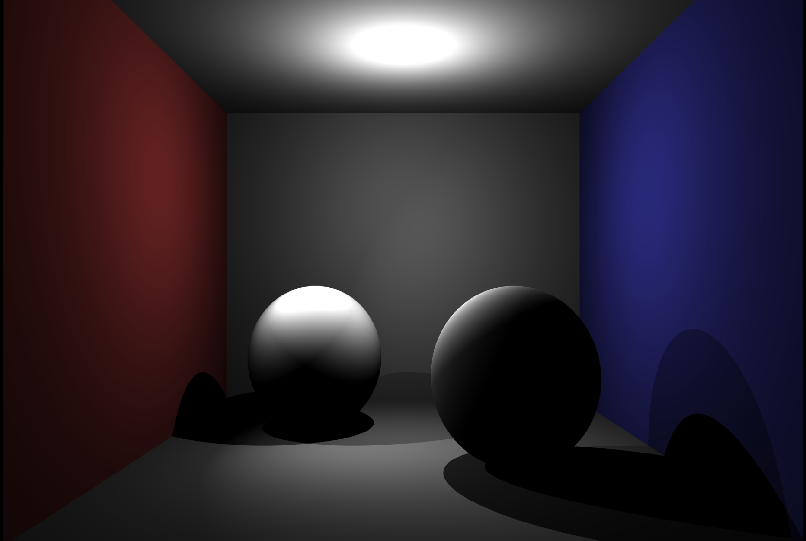

---
title:		"2026Fall-Render-from-Scratch"
sections: 	[project]
publishedAt:	"2026-10-01"
---

这这个项目中，我打算从零开始实现一个自己的光线追踪渲染器！我的项目主页可以在 GitHub [项目主页](https://github.com/LizPink/2026Fall-Renderer-from-Scratch)找到，这里会同步更新项目的开发信息。

## 代码规范

## 更新日志

### 2026-11-04 漫反射材质

更新了材质设定，在添加了基础光源模块的基础上，引入了基础的材质（Lambert Material）. 这是一个完全漫反射的材质，其 BRDF 为一个常函数。为了检测渲染器的最新功能，我们仍然采用 Cornell Box 作为检测的场景，只不过我们在场景里额外为各个物体添加了 Lambert 材质。

可以看到，在这样一个具有两个光源的直射光场景中，漫反射材质整体不会有特别明亮的反射点。因为没有引入全局光照（间接光照部分），整个场景的亮度还是偏低，有一种比较暗淡的感觉。
